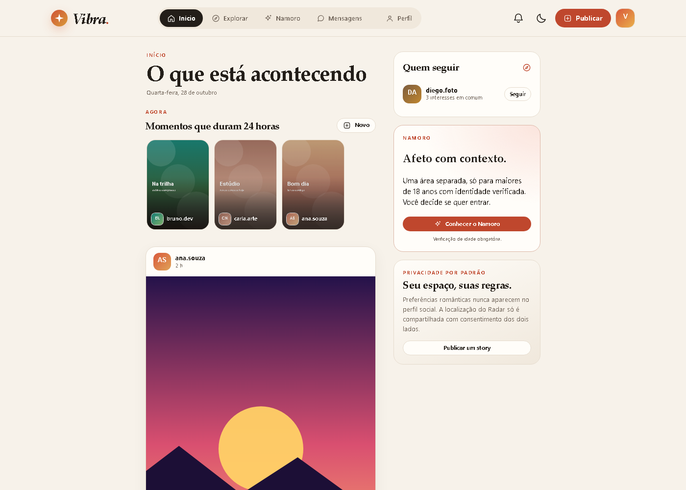

# Vibra 2.0

Rede social local com descoberta de afinidades e uma área de namoro separada, verificada e baseada em consentimento. O projeto é original: não usa código, marca, layout ou imagens do Instagram ou do Tinder.

O escopo completo e o histórico de cada alteração ficam em [`docs/FUNCIONALIDADES.md`](docs/FUNCIONALIDADES.md).



Repositório: [`github.com/oixeol/Rede-social`](https://github.com/oixeol/Rede-social)

---

## Estrutura do projeto (após reorganização)

```
minha-rede-social/
│
├── frontend/                # Aplicação Next.js (React 19)
│   ├── Dockerfile
│   ├── .dockerignore
│   ├── package.json
│   ├── next.config.ts
│   ├── src/
│   └── public/
│
├── backend/                 # Gateway FastAPI + código Django (WIP)
│   ├── Dockerfile
│   ├── .dockerignore
│   ├── main.py              # Entrada FastAPI (uvicorn main:app)
│   ├── requirements.txt     # FastAPI, uvicorn, Django, supabase, etc.
│   ├── manage.py            # Django (migração em andamento)
│   ├── vibra/               # Config Django
│   ├── accounts/, common/, social/, messaging/, dating/  # Apps Django
│   │
│   └── node-api/            # Implementação Node.js funcional (fonte de verdade atual)
│       ├── Dockerfile
│       ├── .dockerignore
│       ├── server.js        # Servidor HTTP + API JSON + SQLite
│       ├── app.config.js
│       ├── package.json
│       ├── lib/
│       ├── public/          # Frontend estático legado
│       ├── qa/              # Testes automatizados + capturas
│       └── scripts/         # Seed de demonstração
│
├── compose.yaml             # (ou docker-compose.yml) Orquestração completa
├── docker-compose.yml       # Arquivo principal de ambiente
├── .env.example             # Modelo de variáveis de ambiente
├── .gitignore
├── .gitattributes
├── README.md
├── docs/
│   ├── FUNCIONALIDADES.md   # Escopo e histórico
│   ├── FASE-1.md            # Registro da Fase 1
│   └── design-tokens.md
└── supabase/
    ├── config.toml
    ├── migrations/          # Schema PostgreSQL (Supabase)
    └── ...
```

> **Nota:** a árvore acima lista os diretórios principais. Arquivos de infraestrutura como `.gitattributes` e pastas `docs/`, `supabase/` permanecem na raiz.

---

## Estado atual

| Componente | Estado | Observações |
| --- | --- | --- |
| Frontend Next.js (porta 3000) | **Funcional** | `npm run dev` com Turbopack, rewrites `/api/*` → backend |
| Backend FastAPI (porta 8000) | **Funcional** | Gateway que repassa `/api/*` e `/uploads/*` para a API Node |
| API Node.js (porta 4173) | **Funcional** | Servidor HTTP + SQLite + seed opcional (fonte de verdade da API) |
| PostgreSQL 18.6 (porta 5432) | **Pronto** | Container com healthcheck e volume `vibra_postgres_data` |
| Django 5.2 + DRF | **Em preparação** | Configuração inicial; apps, models, urls, migrations pendentes |
| Testes automatizados | **Disponíveis** | Suítes fumaça, configuração, Namoro e retenção |
| Landing page (Etapa 3) | **Concluída** | `frontend/src/components/landing/landing-page.tsx` — rota `/` renderiza a landing; CTA "Entrar" → `/entrar` |

> A aplicação web completa (frontend + API) roda hoje via **Node.js + SQLite nativo** (`backend/node-api/server.js`). O backend Python (FastAPI + Django) está em fase de migração; o gateway FastAPI expõe a API na porta 8000 e encaminha para a implementação Node existente, mantendo o contrato estável.

---

## Como rodar com Docker Compose (recomendado)

Requisitos: **Docker Desktop** ou **Docker Engine** com Compose v2.

```powershell
cd C:\Rede-social
docker compose up -d --build
```

O Compose sobe quatro serviços:

| Serviço | Porta | Descrição |
| --- | --- | --- |
| `frontend` | 3000 | Next.js em modo dev (Turbopack, hot reload) |
| `backend` | 8000 | FastAPI gateway (uvicorn --reload) |
| `node-api` | 4173 | API Node.js funcional (SQLite) |
| `postgres` | 5432 | PostgreSQL 18.6 (volume persistente) |

Abra **http://localhost:3000** (frontend). A rota `/` exibe a **Landing Page (Etapa 3)**; ao clicar "Entrar" você é levado a `/entrar` (login) e, após autenticar, ao app em `/inicio`. Os rewrites do Next.js encaminham `/api/*` para o backend (8000), que por sua vez repassa para a API Node (4173).

Para parar mantendo os volumes:
```powershell
docker compose down
```

Para limpar completamente (apaga dados persistidos):
```powershell
docker compose down -v
```

> **Importante:** o frontend usa variáveis de ambiente `NEXT_PUBLIC_*` e `VIBRA_API_ORIGIN` (lidas em tempo de execução pelo `next dev`). O backend FastAPI lê `NODE_API_URL=http://node-api:4173` e as credenciais Supabase do `.env`.

---

## Rodando localmente sem Docker (desenvolvimento)

### Frontend (Next.js)

```powershell
cd C:\Rede-social\frontend
npm ci
npm run dev           # http://localhost:3000
```

### API Node.js (backend/node-api)

Requisitos: **Node.js 22.5+** (usa `node:sqlite` experimental, já disponível).

```powershell
cd C:\Rede-social\backend\node-api
npm ci
npm start             # http://127.0.0.1:4173
```

A primeira execução cria um banco vazio em `backend/node-api/data/vibra.db`. Para popular com cinco perfis de exemplo (apenas desenvolvimento):

```powershell
$env:VIBRA_DEMO_PASSWORD='escolha-uma-senha-forte'; npm run seed:demo
```

A senha precisa ter pelo menos 8 caracteres. `NODE_ENV=production` recusa o comando.

Para usar outra porta:
```powershell
$env:PORT=8080; npm start
```

### Backend Python (FastAPI + Django WIP)

```powershell
cd C:\Rede-social\backend
python -m venv .venv
.\.venv\Scripts\Activate.ps1
pip install -r requirements.txt
uvicorn main:app --host 0.0.0.0 --port 8000 --reload
```

O Django está em `backend/manage.py` e `backend/vibra/`. Os apps (`accounts`, `social`, `messaging`, `dating`) têm models, mas **faltam os `urls.py` de cada app** — a API Django não está pronta. O gateway FastAPI (`main.py`) já serve a API encaminhando para a API Node.

---

## Variáveis de ambiente (modelo em `.env.example`)

| Variável | Padrão | Uso |
| --- | --- | --- |
| `SUPABASE_URL` | — | URL do projeto Supabase (frontend + backend) |
| `SUPABASE_PUBLISHABLE_KEY` | — | Chave anônima para cliente frontend |
| `SUPABASE_SECRET_KEY` | — | Service role key (backend/migração) |
| `DATABASE_URL` | — | Conexão Postgres direta (migração) |
| `VIBRA_API_ORIGIN` | `http://backend:8000` | Origem da API para rewrites Next.js |
| `NODE_API_URL` | `http://node-api:4173` | Upstream da API Node (backend gateway) |
| `VIBRA_DATA_DIR` | `./data` | Diretório do SQLite + uploads (Node) |
| `VIBRA_SEED_DEMO` | `0` | `1` habilita seed de demonstração (proibido em produção) |
| `VIBRA_DEMO_PASSWORD` | (vazio) | Senha mínima 8 caracteres para contas demo |
| `IDENTITY_PROVIDER` | (vazio) | `dev` ou `webhook` (verificação de identidade do Namoro) |
| `IDENTITY_WEBHOOK_SECRET` | — | Segredo HMAC obrigatório se `webhook` |
| `ADMIN_TOKEN` | — | Libera fila de moderação via `X-Admin-Token` |
| `COOKIE_SECURE` | `0` | `1` força cookie `Secure`; produção já força |
| `VIBRA_DB_NAME` | `vibra` | Banco PostgreSQL local |
| `VIBRA_DB_USER` | `vibra` | Usuário PostgreSQL |
| `VIBRA_DB_PASSWORD` | `vibra_dev_password` | Senha PostgreSQL |
| `VIBRA_DB_PORT` | `5432` | Porta PostgreSQL |
| `VIBRA_TZ` | `UTC` | Fuso horário |

> O arquivo `.env` real **não deve ser versionado**. Copie `.env.example` para `.env` e preencha as chaves.

---

## Testes automatizados

Os testes rodam um servidor Node isolado com banco temporário, seed explícito e verificação por webhook assinado.

```powershell
cd C:\Rede-social\backend\node-api
npm test
```

A suíte cobre:
- **Configuração:** produção recusa seed, webhook sem segredo, simulação e cookie sem `Secure`.
- **Fumaça:** login, sessão, feed, exploração, busca, perfis, seguir, curtir, comentar, publicações, carrossel, vídeo, stories, conversas, notificações, privacidade de perfil e fluxo de solicitações de seguimento.
- **Namoro verificado:** bloqueio de menores, data de nascimento imutável, assinatura HMAC inválida, quiz, perfil independente, descoberta sem distância, match idempotente, conversa de namoro, expiração da verificação, Radar bilateral, revogação, localização apagada, bloqueio/desbloqueio, denúncias, moderação, unmatch, fotos validadas.
- **Retenção:** remoção de localização após prazo e invalidação de sessão expirada.

Para rodar a fumaça contra um servidor já em execução:

```powershell
$env:BASE_URL='http://localhost:4173'; node qa/smoke.mjs
```

As capturas de tela em `backend/node-api/qa/` são geradas com Chromium headless via CDP:

```powershell
cd C:\Rede-social\backend\node-api
powershell -NoProfile -ExecutionPolicy Bypass -File qa/shot.ps1 -Out qa/tela.png -Width 1400 -Height 1000
```

---

## Acessibilidade

- Link “Pular para o conteúdo” visível apenas no foco.
- Foco visível em botões, links, campos e controles.
- Contraste reforçado nos textos secundários e nos botões primários.
- Rótulos ARIA nos ícones e nas ações que não têm texto.
- Estados de carregamento, vazio e erro com texto claro.
- Navegação por teclado nos modais, com fechamento por `Esc`.
- Preferência `prefers-reduced-motion` respeitada.
- Áreas de toque de pelo menos 38–44 px nos controles principais.

---

## Identidade visual

O Vibra usa uma linguagem editorial própria:

- papel quente, terracota e verde-teal como cores principais;
- títulos em serifa e texto em sans-serif;
- cartões com bordas suaves, sombras discretas e cantos generosos;
- ícones SVG próprios, desenhados para a interface;
- grade de publicações e cartões de perfil em vez de pilha de swipe.

Os tokens de cor, tipografia e espaçamento ficam no início de `backend/node-api/public/styles.css`.

---

## Limitações

- Projeto local para um único computador. O padrão escuta só em `127.0.0.1` e não está pronto para exposição direta na internet. Produção ainda exige HTTPS, proxy reverso, backups e banco gerenciado.
- Sem credenciais de um provedor real, a verificação de identidade é uma simulação local explícita (`providerMode: dev`). O contrato de webhook está documentado, mas não foi exercitado contra um fornecedor externo.
- Não há recuperação de senha, autenticação em dois fatores, notificações em tempo real, e-mail/push/SMS nem múltiplas instâncias.
- A fila de moderação é local e não substitui uma equipe humana 24/7 nem uma política jurídica de privacidade revisada.
- Uploads ficam em `backend/node-api/data/uploads/`; não há CDN, storage de objetos ou backup automático.
- As imagens de exemplo são SVGs gerados pelo próprio projeto.

---

Projeto local de estudo. Não afiliado ao Instagram ou ao Tinder.